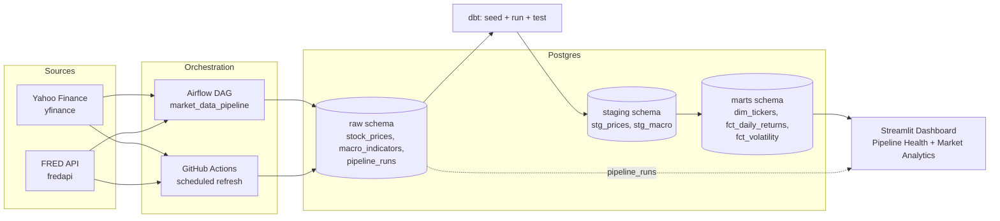

MarketPulse
A market data engineering platform

[GitHub repository](https://github.com/tejasrastogileet/MarketPluse.git)

MarketPulse pulls daily stock prices (Yahoo Finance) and macro-economic
indicators (FRED) from live APIs, loads them into Postgres, transforms them
with dbt into tested analytical tables, and presents the results in a
Streamlit dashboard. Airflow and scheduled GitHub Actions runs execute the
same pipeline code.
What this demonstrates
- Orchestration with failure isolation — an Airflow DAG
  (market_data_pipeline) splits extraction by source (prices vs. macro) so
  one API outage doesn't block the other, with per-task retries and a
  failure callback that logs alerts.
- Data quality as a hard gate, not a suggestion — dbt tests (not-null,
  uniqueness, accepted ranges, and accepted values) run on every load. A
  failing test fails the pipeline run rather than passing silently.
- Idempotent, re-runnable loads — upserts keyed on natural business keys
  (ticker + date, series + date), batched for real network latency, not just
  a local database. Reruns never duplicate data, and source corrections
  overwrite cleanly.
- Observability built in — every pipeline run (status, rows loaded, test
  pass/fail counts) is logged to Postgres and surfaced on the dashboard's
  Pipeline Health tab, so "is this healthy right now" doesn't require a
  terminal.
- Cost-aware infrastructure tradeoffs — a real Airflow scheduler needs an
  always-on process, which costs money to run continuously. A scheduled
  GitHub Actions job calls the same pipeline code as the Airflow DAG, without
  duplicating pipeline logic.
Architecture

Tech stack
Python · Airflow · dbt · PostgreSQL (Neon) · Streamlit · GitHub Actions · Docker
Data quality approach
- Idempotent loads: INSERT ... ON CONFLICT DO UPDATE on (ticker, trade_date)
  / (series_id, obs_date) — reruns never create duplicates, and revised
  source values (Yahoo Finance occasionally restates a recent close) overwrite
  cleanly.
- dbt tests: not-null, uniqueness, and accepted-range/accepted-values
  checks on staging and mart models. dbt source freshness thresholds are
  configured for the raw sources.
- dbt test failures fail the DAG/Action run and are recorded (with failure
  counts) in raw.pipeline_runs. Check the run status before treating model
  outputs as validated.
Why this project
Most side projects that touch market data pull a CSV, plot it in a notebook,
and stop there. MarketPulse is built the way a real data platform has to
work: sources fail or serve bad data (Yahoo Finance occasionally returns a
garbage price for a ticker on non-trading days — this pipeline detects and
filters it before it reaches raw), infrastructure costs money, and a
dashboard is only as trustworthy as the pipeline feeding it is observable.
So the emphasis here isn't the stock charts — it's the plumbing underneath
them: orchestration that isolates failures per source instead of one
monolithic script, tests that block bad data before it ships, loads that are
safe to rerun, and a monitoring table that answers "is this healthy right
now" without opening a terminal. The two-scheduler setup (Airflow DAG + GitHub Actions) is itself a deliberate
cost/reliability tradeoff, not duplicated effort — both call into one shared
pipeline module so the logic can't drift apart.
What I'd change for a real production deployment
- Bake a custom Airflow image instead of installing dependencies at
  container start (_PIP_ADDITIONAL_REQUIREMENTS is fast to iterate with
  locally, not recommended for production).
- Use a secrets manager (Vault, AWS Secrets Manager) instead of .env files
  and platform-native secrets.
- Move off single-node Airflow LocalExecutor to CeleryExecutor /
  KubernetesExecutor for a multi-team deployment.
- Replace the hand-rolled raw.pipeline_runs monitoring table with Airflow's
  own metadata API plus a proper observability stack (Datadog/Grafana).
Repo structure
extraction/          Python package: config, extraction, load, and the
                      shared pipeline entrypoint. Both Airflow and GitHub
                      Actions call into this - no duplicated logic.
dbt/                  dbt project: staging models, marts, seeds, tests.
airflow/              Airflow DAG + its own docker-compose (own metadata DB).
dashboard/            Streamlit app + its own theme module + a minimal
                      requirements.txt for cloud deployment.
.github/workflows/    CI (lint + tests + full mock-data pipeline run) and
                      the scheduled live-data refresh.
tests/                Unit tests against the synthetic data generator - no
                      network access needed to run CI.
docker-compose.yml    The warehouse Postgres (local dev).
Running Locally

Prerequisites: Git, Docker Desktop with Docker Compose v2, Python 3.11, a
Neon PostgreSQL database, and a FRED API key (or use mock data for extraction).

1. Clone the repository and enter the project directory:

   ```powershell
   git clone https://github.com/tejasrastogileet/MarketPluse.git
   cd MarketPluse\market-data-platform
   ```

2. Create and configure `.env` from the example:

   ```powershell
   Copy-Item .env.example .env
   ```

   On macOS/Linux, use `cp .env.example .env`. Set `POSTGRES_HOST`,
   `POSTGRES_PORT`, `POSTGRES_DB`, `POSTGRES_USER`, and `POSTGRES_PASSWORD`
   to your Neon connection values, and set `FRED_API_KEY`. Use the host name
   only for `POSTGRES_HOST`, port `5432`, and keep the Neon password and API
   key in `.env`—never in the README or a committed profile. `.gitignore`
   excludes `.env`; `.env.example` contains sample values that you must replace
   with your own. To use synthetic extraction data instead of Yahoo Finance and
   FRED, add `USE_MOCK_DATA=true` to `.env` (a PostgreSQL connection is still
   required).

3. Set up Python dependencies and configure dbt:

   ```powershell
   py -3.11 -m venv .venv
   .\.venv\Scripts\Activate.ps1
   python -m pip install -r requirements.txt
   ```

   On macOS/Linux, create the environment with `python3.11 -m venv .venv`
   and activate it with `source .venv/bin/activate`. The requirements include
   dbt Core and the Postgres adapter. Airflow's Compose setup copies
   `dbt/profiles.yml.example` to the ignored local file `dbt/profiles.yml`;
   after initialization, make sure that file's host, port, database, and user
   match Neon. It already reads the password from `POSTGRES_PASSWORD` and
   requires `sslmode: require`; do not put the password directly in the file.

4. Start the local Airflow services:

   First create the shared Docker network once if it does not already exist:

   ```powershell
   docker network create market_net
   ```

   If Docker reports that `market_net` already exists, continue. Then start
   Airflow from the project root:

   ```powershell
   docker compose --env-file .env -f airflow/docker-compose.yaml up -d
   ```

   The `airflow-postgres` container is a local database used only for Airflow
   metadata. Market data is stored in Neon, configured with the `POSTGRES_*`
   variables in `.env`; do not point Airflow's metadata database at Neon. The
   root `docker-compose.yml` is an optional local market-data PostgreSQL
   instance and is not needed when using Neon.

5. Prepare dbt and run the pipeline:

   After the Airflow initialization service has completed and you have checked
   `dbt/profiles.yml`, install the dbt project packages in the Airflow
   scheduler container:

   ```powershell
   docker compose --env-file .env -f airflow/docker-compose.yaml exec airflow-scheduler dbt deps --project-dir /opt/airflow/dbt --profiles-dir /opt/airflow/dbt
   ```

   Open Airflow at [http://localhost:8080](http://localhost:8080) and sign in
   using the local credentials configured in `airflow/docker-compose.yaml`.
   Find `market_data_pipeline`, unpause it if needed, and select **Trigger DAG**.
   Open the DAG run and review its task logs. A successful `dbt_seed`, `dbt_run`,
   and `dbt_test` confirms the seed, models, and data quality tests completed;
   the final task records the run in `raw.pipeline_runs`.

   To stop the Airflow services while retaining their data volumes:

   ```powershell
   docker compose --env-file .env -f airflow/docker-compose.yaml down
   ```

   To run the dashboard locally after the pipeline has populated the database:
   `streamlit run dashboard/app.py`.